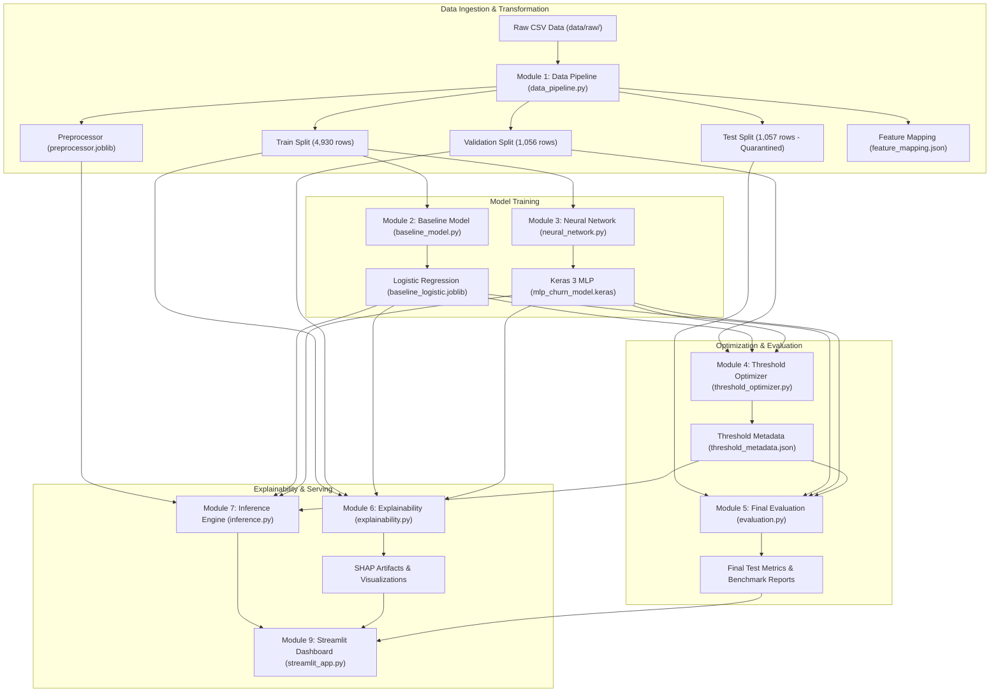

# ChurnIQ: System Architecture & Data Flow Specification

**Document Version:** 1.0.0  
**Status:** Approved / Production  
**Target Environment:** Windows 11 AMD64 | Python 3.12.10 | Keras 3 (PyTorch CPU backend)  

---

## 1. System Overview

**ChurnIQ** is an enterprise-grade customer churn prediction and risk stratification platform. The system is designed around modular components, deterministic reproducibility, strict data isolation, and model explainability.



---

## 2. Component Breakdown

### 2.1 Module 1: Data Pipeline (`src/data_pipeline.py`)
- **Inputs:** `data/raw/WA_Fn-UseC_-Telco-Customer-Churn.csv` (7,043 rows, 21 columns).
- **Core Operations:**
  - Validates required columns against `ALL_REQUIRED_COLS`.
  - Imputes empty whitespace strings in `TotalCharges` to `0.0` for accounts with `tenure == 0`.
  - Quarantines `customerID` as non-predictive metadata.
  - Maps `Churn` target (`No` -> 0, `Yes` -> 1).
  - Executes a stratified 70/15/15 partition with `random_state=42`.
  - Fits `ColumnTransformer` (StandardScaler on continuous columns; OneHotEncoder with `handle_unknown='ignore'` on categorical columns) strictly on the training partition.
  - Transforms all three partitions and serializes to Apache Parquet.
- **Outputs:**
  - `data/processed/train_split.parquet` (4,930 rows, 48 cols: ID + 46 features + Churn)
  - `data/processed/val_split.parquet` (1,056 rows, 48 cols)
  - `data/processed/test_split.parquet` (1,057 rows, 48 cols)
  - `models/preprocessor.joblib`
  - `models/feature_mapping.json`

### 2.2 Module 2: Baseline Model (`src/baseline_model.py`)
- **Inputs:** `train_split.parquet`, `val_split.parquet`.
- **Model:** $L_2$-regularized Logistic Regression (`solver='lbfgs'`, `C=1.0`, `class_weight='balanced'`).
- **Core Operations:**
  - Trains linear baseline on 4,930 training records across 46 features.
  - Generates validation probabilities and baseline validation metrics at threshold 0.50.
- **Outputs:**
  - `models/baseline_logistic.joblib`
  - `reports/baseline_validation_metrics.json`
  - `reports/baseline_val_predictions.parquet`

### 2.3 Module 3: Deep Neural Network (`src/neural_network.py`)
- **Inputs:** `train_split.parquet`, `val_split.parquet`.
- **Runtime:** Keras 3.15.1 over PyTorch 2.15.0+cpu backend (`KERAS_BACKEND=torch`).
- **Model Topology:**
  - Input: 46 dimensions.
  - Hidden 1: 64 units, ReLU, $L_2(0.001)$ regularization.
  - Dropout 1: Rate 0.25.
  - Hidden 2: 32 units, ReLU, $L_2(0.001)$ regularization.
  - Dropout 2: Rate 0.25.
  - Hidden 3: 16 units, ReLU, $L_2(0.001)$ regularization.
  - Output: 1 unit, Sigmoid activation.
- **Training Protocol:** Adam optimizer ($\eta = 0.001$), Binary Cross-Entropy loss with computed training class weights ($W_0 \approx 0.68$, $W_1 \approx 1.88$), batch size 32. Early stopping on `val_loss` with patience=3 restores optimal weights (converged epoch 14, optimal epoch 11).
- **Outputs:**
  - `models/mlp_churn_model.keras`
  - `reports/mlp_validation_metrics.json`
  - `reports/mlp_training_history.json`
  - `reports/mlp_val_predictions.parquet`

### 2.4 Module 4: Threshold Optimizer (`src/threshold_optimizer.py`)
- **Inputs:** `baseline_val_predictions.parquet`, `mlp_val_predictions.parquet`.
- **Core Operations:**
  - Verifies record and label alignment between validation predictions.
  - Evaluates decision thresholds $\tau \in [0.05, 0.95]$ in increments of $0.01$ (91 steps) independently for each model.
  - Selects the optimal threshold $\tau^*$ maximizing $F_1$-score using a deterministic tie-breaking rule (lowest threshold among max-$F_1$ candidates).
  - Encodes business risk boundaries (Low $< 0.30$, Medium $0.30 - 0.70$, High $\ge 0.70$) decoupled from decision thresholds.
- **Outputs:**
  - `models/threshold_metadata.json` (LR optimal = 0.54, MLP optimal = 0.46)
  - `reports/threshold_optimization_comparison.json`
  - `reports/threshold_search_results.csv` (182 rows)

### 2.5 Module 5: Final Evaluation Engine (`src/evaluation.py`)
- **Inputs:** `test_split.parquet` (quarantined), `threshold_metadata.json`, trained model artifacts.
- **Core Operations:**
  - Executes a single, read-only benchmark pass over the quarantined test partition ($n=1,057$).
  - Strictly prohibits any model fine-tuning, threshold retraining, or data recalculation.
  - Computes full metric suite (ROC-AUC, PR-AUC, Accuracy, Precision, Recall, F1, Specificity, FPR, FNR, Confusion Matrix) at both default (0.50) and optimal thresholds.
  - Conducts validation versus test generalization analysis.
  - Evaluates model trade-offs and checks whether the F1 difference exceeds the empirical threshold of 0.005.
- **Outputs:**
  - `reports/final_test_metrics.json`
  - `reports/final_test_predictions.parquet`
  - `reports/model_comparison.csv`
  - `reports/figures/confusion_matrices_test.png`
  - `reports/figures/roc_pr_curves_test.png`

### 2.6 Module 6: Explainability Engine (`src/explainability.py`)
- **Inputs:** `train_split.parquet`, `val_split.parquet`, `feature_mapping.json`, trained models.
- **Core Operations:**
  - Constructs a representative background dataset of 75 actual training records, stratified by churn class (55 non-churners, 20 churners).
  - Initializes model-agnostic `KernelExplainer` for both models.
  - Computes global feature sensitivity over a sample of 200 validation records ($nsamples=100$).
  - Maps 46 encoded dummy features back to 19 parent customer attributes.
  - Generates beeswarm summary plots, global importance bar plots, and 4 archetype local waterfall plots (TP, TN, FP, FN).
- **Outputs:**
  - `models/shap_background.joblib` (75, 46)
  - `reports/shap_global_importance.csv`
  - `reports/shap_local_explanations.json`
  - 12 diagnostic PNG plots in `reports/figures/`

### 2.7 Module 7: Inference Engine (`src/inference.py`)
- **Class:** `ChurnIQInference` (Lazy singleton pattern).
- **Capabilities:**
  - Single-record prediction from raw customer dictionary (`predict_one_raw`).
  - Single-record prediction from 46-feature encoded vector (`predict_one_encoded`).
  - Batch prediction from raw DataFrame (`predict_batch_raw`).
  - Batch prediction from encoded DataFrame (`predict_batch_encoded`).
  - Fast feature contribution proxy extraction.
  - Decoupled business risk stratification assignment (Low, Medium, High).
  - Robust handling of novel or unseen categorical levels via one-hot encoder ignoring unknowns.
- **Outputs:**
  - `reports/inference_predictions_mlp.parquet`
  - `reports/inference_predictions_logistic_regression.parquet`

### 2.8 Module 8: Master Orchestrator (`src/train.py`)
- **CLI Interface:** Coordinates pipeline execution with fine-grained stage selection (`--stages 1,2,3...`), dependency verification (`--check-deps`), status inspection (`--status`), and safety guards against re-running the test set benchmark without explicit overrides.

### 2.9 Module 9: Streamlit Dashboard (`app/streamlit_app.py`)
- **Pages:** Overview, Model Performance, Threshold Analysis, Risk Stratification, SHAP Explainability, Individual Prediction, Pipeline Status.
- **Architecture:** Zero model training or live SHAP calculation during UI rendering. All visualizations load from precomputed cached artifacts (`@st.cache_data`).
- **Styling:** Custom dark-theme CSS (`app/styles/custom.css`) and modular Plotly chart factories (`app/components/charts.py`).

### 2.10 Module 10: Automated Test Suite (`tests/`)
- **Framework:** `pytest 9.2.0` with `pytest-cov`.
- **Suite:** 64 tests (41 unit, 23 integration) with 100% pass rate.
- **Execution markers:** `unit`, `integration`, `slow`.

---

## 3. End-to-End Data Flow

```mermaid
sequenceDiagram
    autonumber
    actor Engineer as ML Engineer
    participant Pipeline as Data Pipeline (src/data_pipeline.py)
    participant Models as Training (src/baseline_model.py, src/neural_network.py)
    participant Opt as Threshold Optimizer (src/threshold_optimizer.py)
    participant Eval as Final Evaluator (src/evaluation.py)
    participant XAI as Explainability (src/explainability.py)
    participant Inf as Inference Engine (src/inference.py)
    actor User as Business User / UI

    Engineer->>Pipeline: Run Data Ingestion & Preprocessing
    Pipeline-->>Pipeline: Clean TotalCharges (tenure=0), Split 70/15/15
    Pipeline-->>Pipeline: Fit Scaler/Encoder on Train only (46 features)
    Pipeline-->>Models: Write train_split, val_split, test_split (quarantined)

    Engineer->>Models: Train Baseline LR & Keras 3 MLP
    Models-->>Opt: Emit validation predictions

    Engineer->>Opt: Optimize F1 threshold on Validation
    Opt-->>Opt: Grid search [0.05, 0.95], deterministic tie-breaking
    Opt-->>Eval: Emit threshold_metadata.json (LR=0.54, MLP=0.46)

    Engineer->>Eval: Execute Single-Pass Test Benchmark
    Eval-->>Eval: Read test_split.parquet (read-only, no tuning)
    Eval-->>Engineer: Emit final_test_metrics.json & model_comparison.csv

    Engineer->>XAI: Generate SHAP Attributions
    XAI-->>XAI: Sample 75 real training records for background
    XAI-->>XAI: Compute KernelExplainer on validation sample
    XAI-->>Inf: Save background dataset & global importance

    User->>Inf: Submit Customer Profile
    Inf-->>Inf: Preprocess via saved ColumnTransformer
    Inf-->>Inf: Score probability & assign business risk tier
    Inf-->>User: Return Churn Probability, Risk Category & Top Features
```

---

## 4. Security, Isolation, and Compatibility Guarantees

1. **Quarantined Test Partition:** The test dataset (`data/processed/test_split.parquet`) is strictly isolated. Modules 1 through 4 and Module 6 have no filesystem read access to the test partition. Module 5 accesses it once in read-only mode.
2. **Metadata Protection:** `customerID` is never encoded or passed as a numerical or categorical feature to any model.
3. **Application Control Policy Compliance:** TensorFlow 2.17.1 C-extensions are blocked on Windows 11 by Smart App Control (SAC). To prevent policy violations, ChurnIQ utilizes Keras 3 with the official PyTorch CPU backend (`KERAS_BACKEND=torch`). No system security policies or registry settings were modified.
4. **Offline Operational Capability:** All dashboard and inference workflows function entirely offline with zero external API dependencies.

