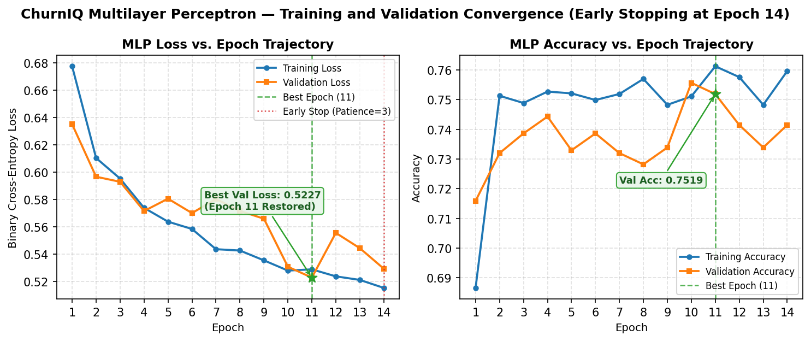
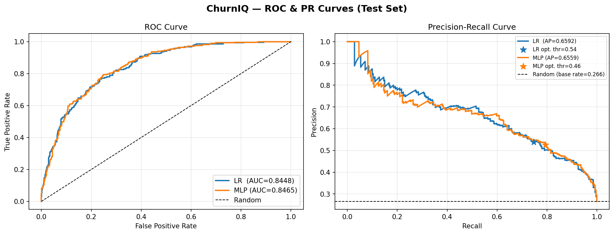
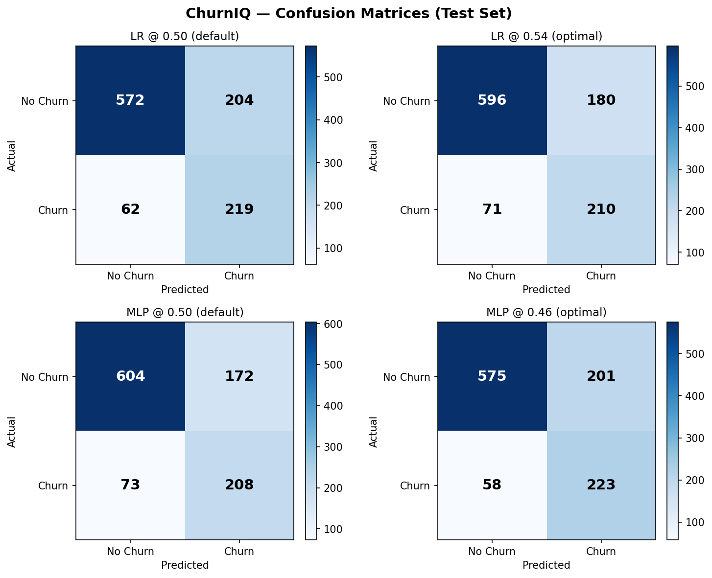
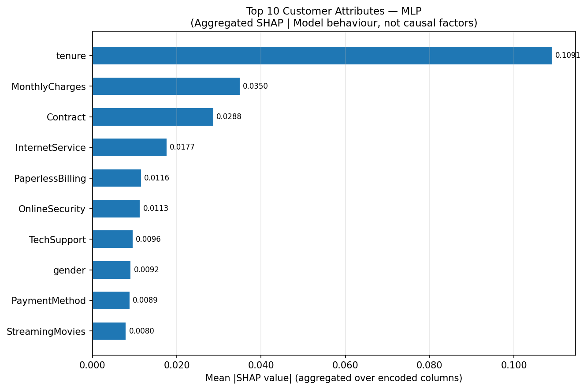
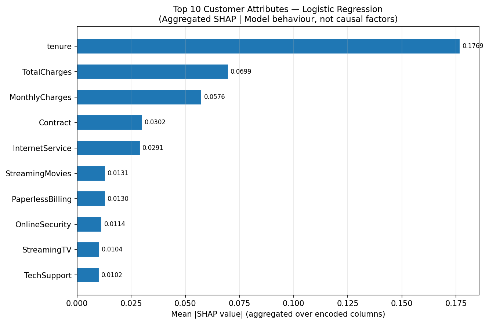
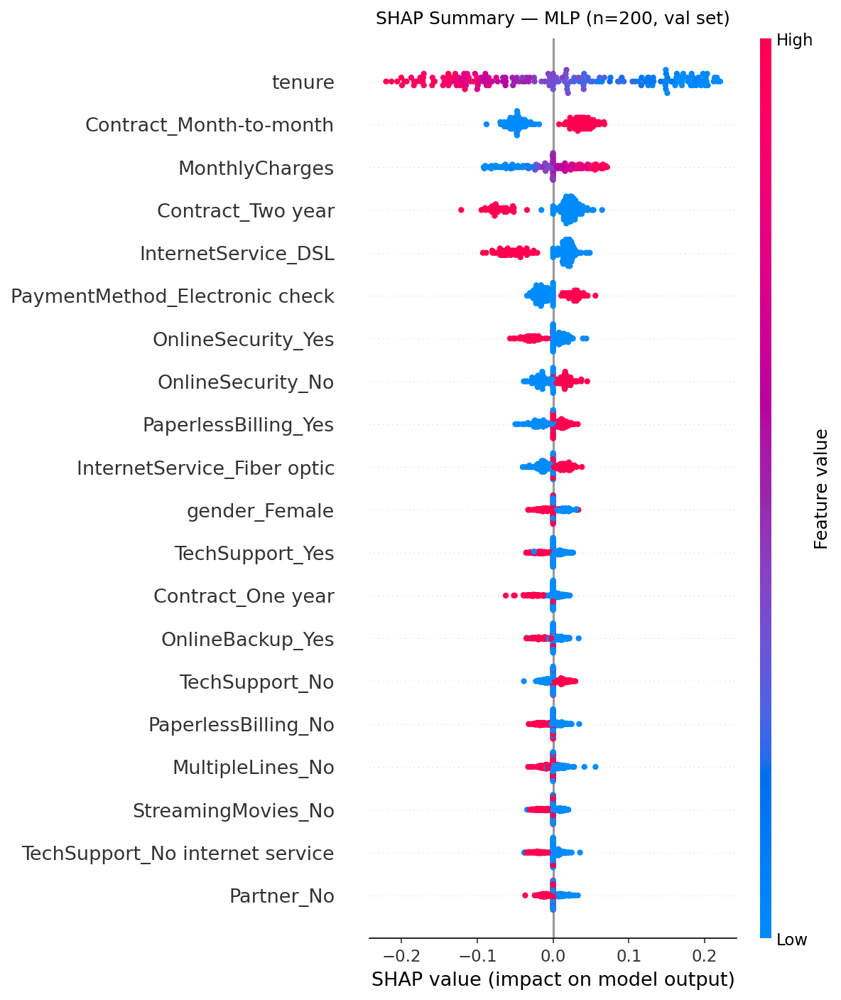
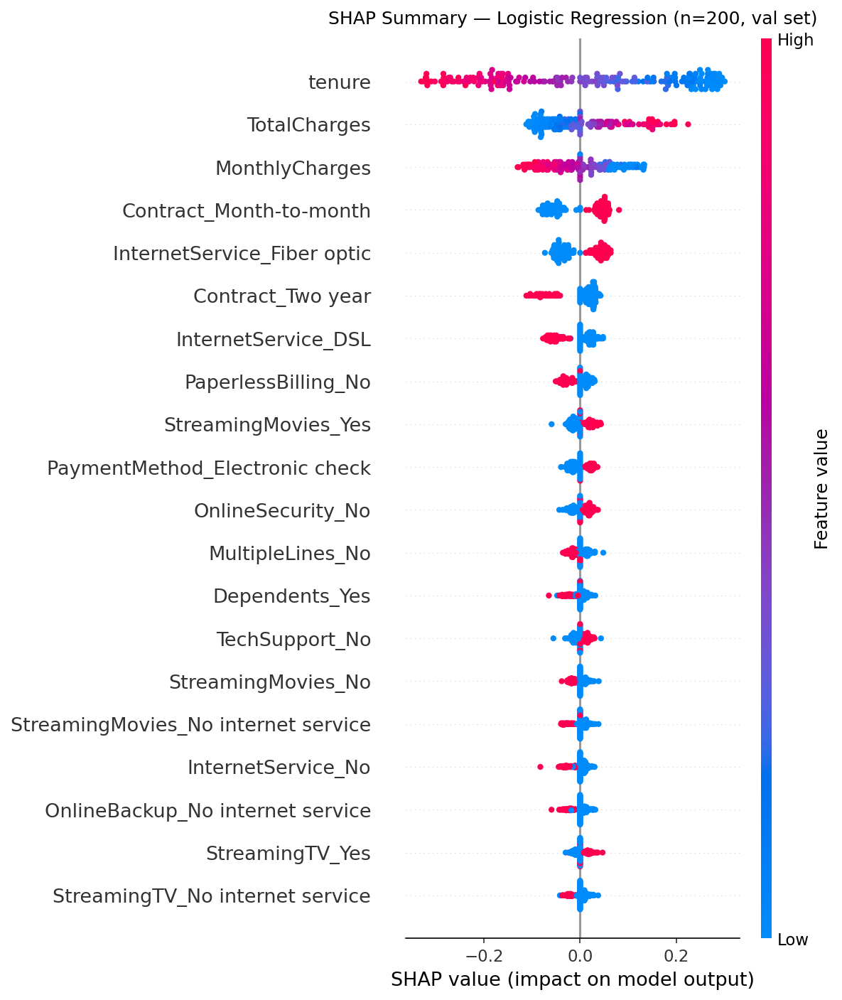

# ChurnIQ: AI-Powered Telecom Customer Churn Prediction System
## Academic Project Report & Comprehensive Technical Evaluation

---

**Course:** AI & ML II (CSR311)  
**Project Title:** ChurnIQ – AI-Powered Telecom Customer Churn Prediction System  
**Project Version:** 1.0.0  
**Student Name:** Shaik Irfan  
**Roll Number:** 44  
**Registration Number:** 12407809  
**Programme:** B.Tech Computer Science and Engineering (AI & Data Engineering)  
**Institution:** Lovely Professional University, Phagwara, Punjab  
**Date of Submission:** November 2026  

---

### Executive Abstract

Customer attrition (churn) directly impacts recurring revenue in subscription-based telecommunications. This report presents **ChurnIQ**, an end-to-end, leakage-free machine learning and deep learning system developed on the benchmark IBM Telco Customer Churn dataset ($N = 7,043$) [1]. To avoid methodological pitfalls prevalent in standard churn modeling, ChurnIQ strictly enforces data isolation via a 70/15/15 stratified partition, fitting all feature transformations exclusively on training data using Scikit-learn [4]. A customized Deep Multilayer Perceptron (MLP)—architected with 46 input features, three regularized hidden layers ($46 \rightarrow 64 \rightarrow 32 \rightarrow 16 \rightarrow 1$), ReLU activations, hidden-layer $L_2$ regularization ($\lambda = 0.001$), inverted dropout ($p = 0.25$) [6], and 5,633 trainable parameters—was implemented in Keras 3 [2] over the PyTorch CPU backend [3]. The network is optimized via the Adam algorithm [5] under a class-weighted binary cross-entropy loss [8] to counteract class imbalance. The MLP is benchmarked against an $L_2$-penalized Logistic Regression baseline [4]. Decision thresholds were optimized independently on validation data to maximize the $F_1$-score, yielding $\tau^* = 0.46$ for the MLP and $\tau^* = 0.54$ for Logistic Regression. 

In a frozen, single-pass evaluation on the quarantined test partition ($n = 1,057$, containing 281 ground-truth churners), the MLP achieved an $F_1$-score of **0.6326** ($\text{ROC-AUC} = 0.8465$, $\text{Recall} = 79.36\%$, $\text{Precision} = 52.59\%$, capturing 223 churners), while Logistic Regression achieved an $F_1$-score of **0.6259** ($\text{ROC-AUC} = 0.8448$, $\text{Recall} = 74.73\%$, $\text{Precision} = 53.85\%$, $\text{PR-AUC} = 0.6592$). Evaluated at their respective validation-optimized thresholds, the MLP demonstrated slightly higher test $F_1$ and recall, whereas Logistic Regression exhibited higher PR-AUC and precision; this $F_1$ difference is small ($\Delta F_1 = +0.0067$), and statistical significance was not formally tested. Model-agnostic Explainable AI (SHAP KernelExplainer) [7] grounded in 75 stratified real training records revealed account tenure, monthly charges, and contract terms as the dominant predictive drivers for the MLP, with internet service and online security exhibiting smaller secondary contributions. Crucially, SHAP attributions reflect model associative sensitivity rather than real-world causality. Finally, predictions are operationalized through a decoupled 3-tier business risk stratification engine (Low: $P < 0.30$, Medium: $0.30 \le P < 0.70$, High: $P \ge 0.70$), an interactive 7-page Streamlit dashboard [9], and an 85-test automated verification suite built with pytest [10].

---

# Section 1: Problem Definition and Dataset Description

#### 1.1 Telecom Customer Churn Problem
In subscription telecommunications (e.g., cellular service, home broadband, streaming bundles), customer attrition—commonly designated as "churn"—refers to the phenomenon where a subscriber cancels their contract or migrates to a competing provider. Because telecommunications markets in developed economies have reached high penetration and saturation, net subscriber growth cannot rely purely on unserviced market expansion. Instead, service providers operate in a mature, competitive landscape where customer acquisition typically incurs substantially higher sales, marketing, and onboarding expenses than proactive customer retention.

Consequently, predictive churn modeling serves as a critical strategic imperative:
1. **Recurring Revenue Preservation:** Proactive identification of at-risk subscribers allows providers to stabilize Monthly Recurring Revenue (MRR) and mitigate subscriber lifetime value erosion.
2. **Potential Asymmetric Error Costs:** In churn management, classification errors carry asymmetric operational implications:
   - A **False Negative (FN)**—failing to identify a customer who is considering churn—poses an operational risk of unaddressed subscriber defection, potentially forfeiting future recurring revenue if the subscriber leaves without intervention.
   - A **False Positive (FP)**—flagging a retained subscriber as at-risk—may incur operational costs such as staff outreach time, unnecessary customer contact, or unneeded promotional discount offers.
   Therefore, higher recall on the positive churn class is typically prioritized to mitigate defection risks, provided false positive costs remain within budgeted retention margins.
3. **Actionable Retention:** Predictions must be accompanied by granular explanations so customer retention agents can address specific subscriber grievances (e.g., pricing dissatisfaction, inadequate tech support, or contract inflexibility).

#### 1.2 Project Objectives and Scope
The ChurnIQ system was designed to address three systemic failures observed in industry churn workflows:
- **Eliminate Data Leakage:** Ensure data cleaning, imputation, and feature transformations are fitted strictly on training data without contaminating validation or test sets.
- **Overcome Default Threshold Biases:** Eliminate the arbitrary default decision threshold of $\tau = 0.50$, tuning decision boundaries on validation data to maximize operational $F_1$-score.
- **Provide Model-Agnostic Explainability:** Bridge deep neural network predictions with frontline retention specialists via SHAP feature attributions [7].

#### 1.3 Dataset Description
The system is built and benchmarked using the authoritative **IBM Telco Customer Churn** dataset (`WA_Fn-UseC_-Telco-Customer-Churn.csv`) [1]. The dataset contains $N = 7,043$ individual subscriber records, each documented across 21 original columns:
- **Demographics (4 columns):** `gender`, `SeniorCitizen`, `Partner`, `Dependents`.
- **Subscribed Telephony & Internet Services (9 columns):** `PhoneService`, `MultipleLines`, `InternetService` (DSL, Fiber optic, No), `OnlineSecurity`, `OnlineBackup`, `DeviceProtection`, `TechSupport`, `StreamingTV`, `StreamingMovies`.
- **Account Contracting & Billing (7 columns):** `tenure` (months active), `Contract` (Month-to-month, One year, Two year), `PaperlessBilling`, `PaymentMethod` (Electronic check, Mailed check, Bank transfer, Credit card), `MonthlyCharges`, `TotalCharges`, and metadata key `customerID`.
- **Target Variable (1 column):** `Churn` (`Yes` or `No`).

#### 1.4 Class Distribution and Imbalance
The target distribution demonstrates a natural class imbalance representative of real-world telecommunications:
- **Non-Churners (`Churn = No`):** 5,174 subscribers ($73.46\%$)
- **Churners (`Churn = Yes`):** 1,869 subscribers ($26.54\%$)
- **Imbalance Ratio:** Approximately $2.77 : 1$.

Because nearly three-quarters of the dataset represents non-churners, naive classifiers predicting the majority class would achieve an apparent accuracy of $73.46\%$ while completely failing to identify any churners ($0\%$ recall). This imbalance necessitates specialized handling through stratified sampling, balanced loss weighting [8], and validation threshold tuning.

#### 1.5 Rationale for Identifier Exclusion (`customerID`)
The `customerID` attribute consists of unique arbitrary alphanumeric identifiers (e.g., `7590-VHVEG`). It was strictly excluded from the predictive feature set. Unique identifiers have maximal cardinality ($7,043$ unique values for $7,043$ rows) and carry zero generalizable predictive signal regarding subscriber behavior. Including identifier tokens in a parametric model or neural network risks arbitrary memorization and overfitting on spurious training noise. In ChurnIQ, `customerID` is isolated purely as an immutable tracking key in auxiliary metadata.

---

# Section 2: Data Preprocessing and Leakage Prevention

```
Raw Dataset (7,043 rows, 21 columns)
        │
        ▼
Data Hygiene & Sanitization (TotalCharges whitespace -> 0.0, Target -> {0, 1})
        │
        ▼
3-Way Stratified Partitioning (Random Seed = 42)
  ├── Training Partition:   4,930 rows (70.0%) [1,308 churners, 3,622 non-churners]
  ├── Validation Partition: 1,056 rows (15.0%) [  280 churners,   776 non-churners]
  └── Test Partition:       1,057 rows (15.0%) [  281 churners,   776 non-churners] (Quarantined)
        │
        ▼
ColumnTransformer Pipeline (Fitted Exclusively on Training Partition via Scikit-learn)
  ├── 3 Numeric Columns:     StandardScaler (fit on Train) -> tenure, MonthlyCharges, TotalCharges
  └── 16 Categorical Columns: OneHotEncoder(handle_unknown='ignore') -> 43 orthogonal dummy features
        │
        ▼
Exact Output Feature Vector: 46 Predictive Features
```

#### 2.1 Data Hygiene & Anomaly Resolution
During schema inspection, 11 subscriber records were identified containing whitespace strings (`" "`) within the `TotalCharges` field. Converting this column to floating-point representation without prior sanitization causes parser failure. 

Crucially, an audit of these 11 records demonstrated that every record had an account `tenure == 0`. These records represent newly onboarded subscribers who enrolled during the current active billing cycle and had not yet completed their first monthly billing cycle. Dropping these 11 rows would introduce sample selection bias, and imputing them with the global mean or median would introduce false historical spend. The mathematically sound resolution was imputing `TotalCharges = 0.0`, reflecting their true zero billing history. Target binarization mapped `No` to $0$ and `Yes` to $1$.

#### 2.2 Stratified Partitioning Protocol
To ensure rigorous validation without distribution shift, the sanitized dataset was split using a **70/15/15 stratified partition** seeded deterministically (`seed=42`):
- **Training Set:** 4,930 records (1,308 churners, $26.53\%$)
- **Validation Set:** 1,056 records (280 churners, $26.52\%$)
- **Test Set:** 1,057 records (281 churners, $26.58\%$)

Stratification guarantees that the $2.77:1$ class balance is identically preserved across all three splits. Set intersection verification confirms zero customer ID overlap across partitions ($|\mathcal{S}_{\text{train}} \cap \mathcal{S}_{\text{val}}| = 0$, $|\mathcal{S}_{\text{train}} \cap \mathcal{S}_{\text{test}}| = 0$).

#### 2.3 Feature Transformation Pipeline
Features are categorized and transformed using an automated Scikit-learn `ColumnTransformer` [4]:
1. **Continuous Scaling (3 features):** `tenure`, `MonthlyCharges`, and `TotalCharges` are scaled to zero mean and unit variance via `StandardScaler`:
   $$z = \frac{x - \mu_{\text{train}}}{\sigma_{\text{train}}}$$
2. **Categorical Encoding (16 features):** Multi-class and binary categorical features are encoded using `OneHotEncoder(drop=None, handle_unknown='ignore')`. This unpacks demographic, service, and contract categories into **43 orthogonal binary dummy columns**.
3. **Total Feature Space:** Combining 3 continuous scaled attributes with 43 one-hot columns produces an exact vector dimension of **46 predictive features**.

#### 2.4 Mathematical Prevention of Data Leakage
Data leakage occurs when information from outside the training partition contaminates model construction. If a preprocessor (such as `StandardScaler` or `OneHotEncoder`) is fitted on the entire dataset prior to splitting, the transformation parameters ($\mu$, $\sigma$, category dictionaries) encode statistical properties of the test set. This produces over-optimistic evaluation metrics that degrade sharply in production.

In ChurnIQ, data leakage is prevented mathematically:
- The `ColumnTransformer` is fitted **exclusively on the training split** ($X_{\text{train}}$).
- The resulting scaling parameters $\mu_{\text{train}}$ and $\sigma_{\text{train}}$ are frozen and serialized into `models/preprocessor.joblib`.
- Validation ($X_{\text{val}}$) and test ($X_{\text{test}}$) partitions are transformed using the frozen parameters.
- Out-of-vocabulary categorical levels in future inference are safely mapped to all-zero vectors via `handle_unknown='ignore'`, preventing runtime exceptions.

---

# Section 3: Neural-Network Implementation

#### 3.1 Network Topology and Layer Dimensions
The primary deep learning model in ChurnIQ is a custom feedforward **Multilayer Perceptron (MLP)** architected specifically for structured tabular classification. The network maps the 46-dimensional input vector to a single churn risk score via three fully connected (Dense) hidden layers with regularization:

$$\text{Input } (46) \longrightarrow \text{Dense}(64) \longrightarrow \text{Dropout}(0.25) \longrightarrow \text{Dense}(32) \longrightarrow \text{Dropout}(0.25) \longrightarrow \text{Dense}(16) \longrightarrow \text{Dense}(1, \text{Sigmoid})$$

| Layer (Type) | Output Shape | Param # | Activation & Regularization |
|---|:---:|:---:|---|
| **Input Layer** | `(None, 46)` | 0 | None (Normalized continuous & one-hot features) |
| **Dense Hidden 1** | `(None, 64)` | 3,008 | ReLU + $L_2$ Regularization ($\lambda = 0.001$) |
| **Dropout 1** | `(None, 64)` | 0 | Inverted Dropout Rate $p = 0.25$ |
| **Dense Hidden 2** | `(None, 32)` | 2,080 | ReLU + $L_2$ Regularization ($\lambda = 0.001$) |
| **Dropout 2** | `(None, 32)` | 0 | Inverted Dropout Rate $p = 0.25$ |
| **Dense Hidden 3** | `(None, 16)` | 528 | ReLU + $L_2$ Regularization ($\lambda = 0.001$) |
| **Output Layer** | `(None, 1)` | 17 | Sigmoid ($\sigma(z) = \frac{1}{1 + e^{-z}}$) — Unregularized |
| **Trainable Parameters** | — | **5,633** | *Active weights and biases across all 4 dense layers* |
| **Non-Trainable Parameters** | — | **0** | *All layer parameters are actively updated during backprop* |

#### 3.2 Exact Trainable Parameter Count Derivation
The number of trainable parameters in a fully connected dense layer connecting an input dimension $n_{\text{in}}$ to an output dimension $n_{\text{out}}$ with bias is given by:

$$P = (n_{\text{in}} \times n_{\text{out}}) + n_{\text{out}}$$

Applying this formula layer by layer:
1. **Hidden Layer 1 (Dense 64):**
   $$P_1 = (46 \times 64) + 64 = 2,944 + 64 = \mathbf{3,008} \text{ parameters}$$
2. **Hidden Layer 2 (Dense 32):**
   $$P_2 = (64 \times 32) + 32 = 2,048 + 32 = \mathbf{2,080} \text{ parameters}$$
3. **Hidden Layer 3 (Dense 16):**
   $$P_3 = (32 \times 16) + 16 = 512 + 16 = \mathbf{528} \text{ parameters}$$
4. **Output Layer (Dense 1):**
   $$P_{\text{out}} = (16 \times 1) + 1 = 16 + 1 = \mathbf{17} \text{ parameters}$$

$$\text{Total Trainable Parameters} = 3,008 + 2,080 + 528 + 17 = \mathbf{5,633} \text{ parameters}$$

*Model Capacity & Complexity Control:* With 5,633 trainable parameters on 4,930 training records, the parameter-to-sample ratio exceeds 1.0. A feedforward network of this size would readily overfit or memorize tabular training patterns if unconstrained. To control model capacity and enforce generalizable representations, ChurnIQ incorporates three explicit complexity-control mechanisms: hidden-layer $L_2$ regularization ($\lambda = 0.001$), inverted dropout ($p = 0.25$), and validation-monitored early stopping with best-weight restoration.

#### 3.3 Activation Functions
Non-linear activation functions enable the MLP to learn complex decision boundaries:
1. **Rectified Linear Unit (ReLU):** Applied across all three hidden layers:
   $$f(z) = \max(0, z), \quad f'(z) = \begin{cases} 1 & \text{if } z > 0 \\ 0 & \text{if } z \le 0 \end{cases}$$
   *Academic Justification:* Unlike saturating activations (e.g., Sigmoid or Tanh), ReLU maintains a constant gradient of $1.0$ for positive activations. This substantially mitigates the vanishing gradient problem during backpropagation and accelerates convergence in deep feedforward networks.
2. **Sigmoid (Logistic Activation):** Applied exclusively at the single output neuron:
   $$\sigma(z) = \frac{1}{1 + e^{-z}}, \quad \sigma'(z) = \sigma(z)(1 - \sigma(z))$$
   *Academic Justification:* The Sigmoid function maps real-valued logits $z \in (-\infty, +\infty)$ monotonically into the open interval $\hat{y} \in (0, 1)$. Because the network is trained with balanced class weights ($W_1 \approx 1.8846, W_0 \approx 0.6806$), the continuous output $\hat{y}$ functions as a cost-sensitive **churn risk score** rather than an empirically calibrated posterior probability $P(\text{Churn} = 1 \mid \mathbf{x})$. This continuous risk score is well-suited for validation threshold tuning and business risk stratification.

#### 3.4 Loss Formulation: Class-Weighted Binary Cross-Entropy
For a training sample $(\mathbf{x}_i, y_i)$ with ground-truth binary label $y_i \in \{0, 1\}$ and predicted risk score $\hat{y}_i = \sigma(z_i)$, the Binary Cross-Entropy (BCE) loss incorporates class weighting terms $w_0$ and $w_1$ to combat class imbalance [8]:

$$\mathcal{L}_{\text{BCE}}(y_i, \hat{y}_i) = -\left[ w_1 y_i \ln(\hat{y}_i) + w_0 (1 - y_i) \ln(1 - \hat{y}_i) \right]$$

where $w_1 = \frac{N_{\text{train}}}{2 N_1} \approx 1.8846$ and $w_0 = \frac{N_{\text{train}}}{2 N_0} \approx 0.6806$. For a given sample $i$, the active class weight is denoted $w_{y_i} = y_i w_1 + (1 - y_i) w_0$.

Under the Keras implementation (`regularizers.l2(0.001)`), $L_2$ regularization penalizes the sum of squared weights without a $\frac{1}{2}$ multiplier. The implementation applies $L_2$ regularization exclusively to the three hidden Dense layers ($l \in \{1, 2, 3\}$); the output neuron is unregularized. The overall mini-batch objective for $m$ samples is:

$$\mathcal{L}(\theta) = \frac{1}{m} \sum_{i=1}^m \mathcal{L}_{\text{BCE}}(y_i, \hat{y}_i) + \lambda \sum_{l=1}^3 \|W^{[l]}\|_F^2$$

where $\|W^{[l]}\|_F^2 = \sum_{j,k} (W_{jk}^{[l]})^2$ and $\lambda = 0.001$.

*Output Error Derivation:* Differentiating the weighted sample loss $\mathcal{L}_{\text{BCE}}(y_i, \hat{y}_i)$ with respect to the output logit $z_i$:
- For a positive instance ($y_i = 1$):
  $$\frac{\partial \mathcal{L}_{\text{BCE}}}{\partial z_i} = -w_1 \frac{1}{\hat{y}_i} \cdot \sigma'(z_i) = -w_1 \frac{1}{\hat{y}_i} \cdot \hat{y}_i(1 - \hat{y}_i) = -w_1 (1 - \hat{y}_i) = w_1 (\hat{y}_i - 1)$$
- For a negative instance ($y_i = 0$):
  $$\frac{\partial \mathcal{L}_{\text{BCE}}}{\partial z_i} = -w_0 \frac{-1}{1 - \hat{y}_i} \cdot \sigma'(z_i) = w_0 \frac{1}{1 - \hat{y}_i} \cdot \hat{y}_i(1 - \hat{y}_i) = w_0 \hat{y}_i = w_0 (\hat{y}_i - 0)$$

Unifying both cases demonstrates that the per-sample output error term $\delta_i^{[4]}$ is proportional to the weighted residual:

$$\delta_i^{[4]} = \frac{\partial \mathcal{L}_{\text{BCE}}(y_i, \hat{y}_i)}{\partial z_i} = w_{y_i} (\hat{y}_i - y_i)$$

This error signal scales linearly with prediction residual and is amplified by $w_{y_i}$, penalizing positive-class false negatives approximately $2.77\times$ more heavily than false positives.

#### 3.5 Backpropagation and Computational Flow
Backpropagation computes parameter gradients via the multivariable chain rule of calculus:
1. **Forward Propagation:**
   For a mini-batch of $m$ samples represented as row vectors in activation matrix $A^{[l-1]} \in \mathbb{R}^{m \times n_{l-1}}$:
   $$Z^{[1]} = A^{[0]} (W^{[1]})^T + \mathbf{1} (b^{[1]})^T, \quad A^{[1]} = \text{ReLU}(Z^{[1]}) \in \mathbb{R}^{m \times 64}$$
   $$Z^{[2]} = A^{[1]} (W^{[2]})^T + \mathbf{1} (b^{[2]})^T, \quad A^{[2]} = \text{ReLU}(Z^{[2]}) \in \mathbb{R}^{m \times 32}$$
   $$Z^{[3]} = A^{[2]} (W^{[3]})^T + \mathbf{1} (b^{[3]})^T, \quad A^{[3]} = \text{ReLU}(Z^{[3]}) \in \mathbb{R}^{m \times 16}$$
   $$Z^{[4]} = A^{[3]} (W^{[4]})^T + \mathbf{1} (b^{[4]})^T, \quad \hat{Y} = \sigma(Z^{[4]}) \in \mathbb{R}^{m \times 1}$$
   where $A^{[0]} = X \in \mathbb{R}^{m \times 46}$ is the input mini-batch.
2. **Backward Propagation:**
   Let the error matrix be defined as the derivative of loss with respect to pre-activations: $\Delta^{[l]} \equiv \frac{\partial \mathcal{L}}{\partial Z^{[l]}} \in \mathbb{R}^{m \times n_l}$.
   For the unregularized output layer ($l = 4$), the per-sample error vector is the weighted residual:
   $$\Delta_i^{[4]} = w_{y_i} (\hat{y}_i - y_i) \implies \frac{\partial \mathcal{L}}{\partial W^{[4]}} = \frac{1}{m} (\Delta^{[4]})^T A^{[3]}, \quad \frac{\partial \mathcal{L}}{\partial b^{[4]}} = \frac{1}{m} \sum_{i=1}^m \Delta_i^{[4]}$$
   Propagating error backward through each hidden layer $l \in \{3, 2, 1\}$:
   $$\Delta^{[l]} = \left( \Delta^{[l+1]} W^{[l+1]} \right) \odot f'(Z^{[l]})$$
   $$\frac{\partial \mathcal{L}}{\partial W^{[l]}} = \frac{1}{m} (\Delta^{[l]})^T A^{[l-1]} + 2\lambda W^{[l]}$$
   $$\frac{\partial \mathcal{L}}{\partial b^{[l]}} = \frac{1}{m} \sum_{i=1}^m \Delta_i^{[l]}$$
   where $\odot$ denotes the Hadamard element-wise product, $f'(Z^{[l]})$ is the subgradient of the ReLU activation, and $2\lambda W^{[l]}$ is the exact derivative of the Keras $L_2$ penalty ($\lambda \sum W^2$).
   
   Because the error term $\Delta^{[l]} \equiv \frac{\partial \mathcal{L}}{\partial Z^{[l]}}$ already incorporates the activation derivative through the multivariable chain rule and $\frac{\partial Z^{[l]}}{\partial b^{[l]}} = I$, the gradient with respect to the bias vector simplifies directly to the unweighted average of the error vectors across the mini-batch: $\frac{\partial \mathcal{L}}{\partial b^{[l]}} = \frac{1}{m} \sum_{i=1}^m \Delta_i^{[l]}$. No secondary activation derivative is applied.

<div class="page-break"></div>

#### 3.6 Optimization Algorithm: Adam
Optimization is executed via **Adam (Adaptive Moment Estimation)** [5], which maintains individual adaptive learning rates for each parameter by computing exponentially decaying moving averages of past gradients and squared gradients:
1. **First Moment Estimate (Momentum):**
   $$m_t = \beta_1 m_{t-1} + (1 - \beta_1) g_t$$
2. **Second Moment Estimate (Uncentered Variance):**
   $$v_t = \beta_2 v_{t-1} + (1 - \beta_2) g_t^2$$
3. **Bias Corrections (compensating for zero initialization):**
   $$\hat{m}_t = \frac{m_t}{1 - \beta_1^t}, \quad \hat{v}_t = \frac{v_t}{1 - \beta_2^t}$$
4. **Parameter Update Rule:**
   $$\theta_{t+1} = \theta_t - \frac{\eta}{\sqrt{\hat{v}_t} + \epsilon} \hat{m}_t$$

*Hyperparameter Settings:* Learning rate $\eta = 0.001$, batch size = $32$, first-moment decay $\beta_1 = 0.9$, second-moment decay $\beta_2 = 0.999$, and numerical stability constant $\epsilon = 10^{-7}$.

#### 3.7 Regularization Strategy
To prevent overfitting on the $4,930$ training records, ChurnIQ integrates two complementary regularization mechanisms:
1. **$L_2$ Weight Regularization ($L_2$ Penalty):** Applied exclusively to the weight matrices of the three hidden Dense layers with penalty coefficient $\lambda = 0.001$. By penalizing the squared Frobenius norm $\|W\|_F^2$, $L_2$ regularization constrains weight magnitudes, discouraging the network from developing extreme coefficients. The optimizer is standard Adam, operating with $L_2$ loss penalization rather than decoupled weight decay (AdamW).
2. **Inverted Dropout ($p = 0.25$) [6]:** Applied after Hidden Layer 1 and Hidden Layer 2. During each forward training pass, $25\%$ of hidden neuron activations are randomly set to zero. Under inverted dropout, surviving activations are scaled by $\frac{1}{1-p} = \frac{1}{0.75} \approx 1.3333$ during training, preserving expected activation magnitudes ($\mathbb{E}[A^{[l]}] = A^{[l]}$). Consequently, at test and inference time, dropout is deactivated (acting as an identity operation), and **no additional scaling is required during inference**.

#### 3.8 Framework Architecture: Keras 3 with PyTorch CPU Backend
To ensure stability on Windows systems with active Smart App Control (which blocks native TensorFlow C-extensions), the neural network was authored in **Keras 3.15.1** [2] using the **PyTorch 2.15.0+cpu** backend [3] (`KERAS_BACKEND=torch`). This guarantees high-performance tensor execution and strict numerical reproducibility without requiring external compilation dependencies.

---

# Section 4: Training and Optimization

#### 4.1 Training Procedure & Hyperparameter Selection
The MLP was trained using mini-batch gradient descent with a batch size of $32$ samples over a maximum budget of $50$ epochs. At each epoch, the dataset was shuffled, and mini-batches were streamed through forward and backward passes.

*Hyperparameter Selection Basis:* Architecture hyperparameters (three hidden layers of $[64, 32, 16]$ units, learning rate $\eta = 0.001$, batch size $32$, dropout rate $0.25$, and $L_2$ coefficient $0.001$) were selected based on standard empirical heuristics and conventional architectural design for tabular deep learning, rather than an automated hyperparameter search (such as grid or random search). Only the decision threshold $\tau^*$ was systematically grid-searched across candidate values on validation data.

#### 4.2 Cost-Sensitive Class Weighting
To prevent the model from defaulting toward non-churner predictions, class weights were calculated using the inverse class frequency heuristic [8]:

$$W_c = \frac{N_{\text{train}}}{2 \cdot N_c}$$

For the training partition ($N_{\text{train}} = 4,930$, $N_0 = 3,622$, $N_1 = 1,308$):
- **Majority Class (Non-Churn, $c=0$):**
  $$W_0 = \frac{4,930}{2 \times 3,622} \approx \mathbf{0.6806}$$
- **Minority Class (Churn, $c=1$):**
  $$W_1 = \frac{4,930}{2 \times 1,308} \approx \mathbf{1.8846}$$

These weights rescale the loss contribution of each sample during backpropagation, penalizing positive-class residuals approximately $2.77\times$ more heavily than negative-class residuals.

#### 4.3 Early Stopping Dynamics and Training Curves
Overfitting was monitored via an `EarlyStopping` callback tracking validation loss (`val_loss`) with:
- `patience = 3`: Training halts if validation loss fails to achieve an improvement over the best historical loss for 3 consecutive epochs.
- `restore_best_weights = True`: Automatically rolls back parameters to the epoch with minimum validation loss.

*Empirical Convergence Trajectory:*
As documented in `reports/mlp_training_history.json`:
- Training began at Epoch 1 ($\text{loss} = 0.6776$, $\text{val\_loss} = 0.6351$).
- Training loss decreased steadily across epochs, reaching $0.5152$ by Epoch 14.
- Validation loss reached its global minimum at **Epoch 11** ($\text{val\_loss} = \mathbf{0.5227}$, $\text{loss} = 0.5288$, $\text{val\_accuracy} = 0.7519$).
- Rather than plateauing, validation loss subsequently increased and fluctuated above the minimum: Epoch 12 ($\text{val\_loss} = 0.5555$), Epoch 13 ($\text{val\_loss} = 0.5443$), and Epoch 14 ($\text{val\_loss} = 0.5293$).
- Because epochs 12, 13, and 14 yielded three consecutive non-improving epochs relative to Epoch 11, early stopping triggered at **Epoch 14**, and `restore_best_weights = True` restored the optimal parameter checkpoint from Epoch 11 into `models/mlp_churn_model.keras`.

  
*Figure 1: Training and validation loss (left) and accuracy (right) trajectories of the ChurnIQ Multilayer Perceptron across 14 optimization epochs. The green dashed line and star mark the optimal validation loss ($0.5227$) at Epoch 11, whose weights were restored upon early stopping triggered at Epoch 14 (patience = 3).*  
*(Verified Path: `reports/figures/mlp_training_history.png`)*

#### 4.4 Validation-Based Threshold Optimization
Standard classification workflows apply an uncalibrated default decision boundary at $\tau = 0.50$. In class-imbalanced and class-weighted settings, $\tau = 0.50$ is not guaranteed to maximize the $F_1$-score. Because the model was trained with class weights ($W_1 \approx 1.8846, W_0 \approx 0.6806$), predicted risk scores are systematically shifted to penalize minority-class errors. Furthermore, the $F_1$-score represents the harmonic mean of precision and recall; an operating threshold calibrated to the empirical validation distribution balances precision and recall more effectively than an arbitrary 0.50 cutoff.

ChurnIQ independently searches for the optimal decision threshold $\tau^*$ that maximizes the $F_1$-score exclusively on the validation set:

$$\tau^* = \arg\max_{\tau \in [0.05, 0.95]} F_1(\tau; \mathcal{D}_{\text{val}})$$

- **Search Resolution:** Grid search across 91 discrete candidate thresholds $\tau \in [0.05, 0.95]$ with step $\Delta \tau = 0.01$.
- **Deterministic Tie-Breaking:** In the event of identical maximal $F_1$ scores, the algorithm selects the **lowest threshold**. In customer retention, capturing additional churners (higher recall) is operationally preferred over marginal precision gains when $F_1$ is tied.

*Validation Optimization Results:*
- **Logistic Regression:**
  - Default Threshold ($\tau = 0.50$): $F_1 = 0.6247$ ($\text{Precision} = 0.5067$, $\text{Recall} = 0.8143$)
  - Optimal Threshold ($\tau^* = \mathbf{0.54}$): $F_1 = \mathbf{0.6329}$ ($\text{Precision} = 0.5220$, $\text{Recall} = 0.8036$)
  - Optimization Delta: $\Delta F_1 = +0.0082$
- **Multilayer Perceptron (MLP):**
  - Default Threshold ($\tau = 0.50$): $F_1 = 0.6289$ ($\text{Precision} = 0.5211$, $\text{Recall} = 0.7929$)
  - Optimal Threshold ($\tau^* = \mathbf{0.46}$): $F_1 = \mathbf{0.6319}$ ($\text{Precision} = 0.5134$, $\text{Recall} = 0.8214$)
  - Optimization Delta: $\Delta F_1 = +0.0030$

The optimal threshold metadata was frozen in `models/threshold_metadata.json` prior to any test set evaluation.

#### 4.5 Data Isolation and Leakage Rationale
The test set was excluded entirely from threshold search. Selecting thresholds on test data constitutes subtle data snooping (evaluating multiple hyperparameter variants on the test set and selecting the best one). By freezing $\tau^*$ using only validation data, the subsequent test evaluation provides an unbiased estimate of real-world generalization.

---

# Section 5: Evaluation and Comparative Benchmark

#### 5.1 Baseline Model Formulation
To provide an interpretable classical benchmark, an $L_2$-penalized **Logistic Regression** model was trained on $X_{\text{train}}$ using Scikit-learn's L-BFGS solver with inverse regularization strength $C = 1.0$ and `class_weight='balanced'` [4].

#### 5.2 Unbiased Final Test Evaluation
The quarantined test partition ($n = 1,057$, 281 ground-truth churners, 776 non-churners) was evaluated in an isolated single pass. Both models were benchmarked at their default threshold ($\tau = 0.50$) and their validation-optimized thresholds ($\tau^* = 0.54$ for Logistic Regression, $\tau^* = 0.46$ for MLP).

| Performance Metric | Logistic Regression (Default $\tau = 0.50$) | Logistic Regression (Optimal $\tau^* = 0.54$) | Multilayer Perceptron (Default $\tau = 0.50$) | Multilayer Perceptron (Optimal $\tau^* = 0.46$) |
|---|:---:|:---:|:---:|:---:|
| **ROC-AUC** | 0.8448 | 0.8448 | 0.8465 | 0.8465 |
| **PR-AUC (Avg Precision)** | 0.6592 | 0.6592 | 0.6559 | 0.6559 |
| **F1-Score** | 0.6222 | 0.6259 | 0.6293 | 0.6326 |
| **Precision** | 0.5177 | 0.5385 | 0.5474 | 0.5259 |
| **Recall (Sensitivity)** | 0.7794 | 0.7473 | 0.7402 | 0.7936 |
| **Accuracy** | 0.7483 | 0.7625 | 0.7682 | 0.7550 |
| **Specificity** | 0.7371 | 0.7680 | 0.7784 | 0.7410 |
| **False Positive Rate (FPR)** | 0.2629 | 0.2320 | 0.2216 | 0.2590 |
| **False Negative Rate (FNR)** | 0.2206 | 0.2527 | 0.2598 | 0.2064 |
| **True Negatives (TN)** | 572 | 596 | 604 | 575 |
| **False Positives (FP)** | 204 | 180 | 172 | 201 |
| **False Negatives (FN)** | 62 | 71 | 73 | 58 |
| **True Positives (TP)** | 219 | 210 | 208 | 223 |

#### 5.3 Comparative Analysis & Metric Trade-Offs
A rigorous examination of the test evaluation reveals important trade-offs between linear and deep architectures when evaluated at their respective validation-optimized operating thresholds:
1. **$F_1$-Score Comparison:** Evaluated at validation-optimized thresholds ($\tau^* = 0.46$ for MLP, $\tau^* = 0.54$ for Logistic Regression), the MLP achieved a slightly higher test $F_1$-score ($0.6326$) than the Logistic Regression baseline ($0.6259$), an absolute margin of $+0.0067$.
2. **Recall Advantage (Capturing Churners):** Evaluated at validation-optimized operating points ($\tau^* = 0.46$ for MLP vs. $\tau^* = 0.54$ for Logistic Regression), the MLP demonstrated higher sensitivity, achieving **$79.36\%$ recall** compared to $74.73\%$ for Logistic Regression. In concrete subscriber counts, the MLP correctly flagged **223 out of 281 churners**, missing only 58 subscribers. Logistic Regression identified 210 churners, missing 71. In business retention operations, capturing 13 additional subscribers directly provides an opportunity to intervene before cancellation. However, this recall advantage is specific to the selected operating points; at the common default threshold of $\tau = 0.50$, Logistic Regression exhibits higher recall ($77.94\%$ vs. $74.02\%$).
3. **Precision & PR-AUC Trade-off:** Logistic Regression achieved higher precision ($53.85\%$ vs. $52.59\%$) and higher Area Under the Precision-Recall Curve ($0.6592$ vs. $0.6559$). By operating at $\tau^* = 0.54$, Logistic Regression was more conservative, producing 21 fewer false positives (180 FP vs. 201 FP).
4. **Discrimination Power (ROC-AUC):** Both models demonstrated strong discrimination across all candidate thresholds, with the MLP achieving $\text{ROC-AUC} = 0.8465$ compared to $0.8448$ for Logistic Regression ($\Delta = +0.0017$).
5. **Statistical Significance & Operating-Point Disclaimer:** The observed $F_1$ difference ($\Delta F_1 = +0.0067$) is modest. Formal statistical hypothesis testing (such as McNemar's test or paired bootstrap resampling) was not conducted. Rather than asserting absolute superiority, we conclude that the models exhibit complementary trade-offs at their optimal thresholds: the MLP provides higher churn capture (recall) at the expense of slightly higher false positives, while Logistic Regression provides slightly cleaner precision. Crucially, these differences primarily reflect the selected operating points rather than an intrinsic architectural advantage. At the common default threshold $\tau = 0.50$, the recall/precision ordering reverses (see Table 5.2), where Logistic Regression achieves higher recall ($77.94\%$ vs. $74.02\%$) and MLP achieves higher precision ($54.74\%$ vs. $51.77\%$).

#### 5.4 Generalization Analysis
Comparing validation performance to final test performance illuminates model stability across partitions:
- **Logistic Regression:** Validation $F_1 = 0.6329 \to$ Test $F_1 = 0.6259$ ($\Delta F_1 = -0.0070$); Validation $\text{ROC-AUC} = 0.8449 \to$ Test $\text{ROC-AUC} = 0.8448$ ($\Delta = -0.0001$).
- **Multilayer Perceptron (MLP):** Validation $F_1 = 0.6319 \to$ Test $F_1 = 0.6326$ ($\Delta F_1 = +0.0007$); Validation $\text{ROC-AUC} = 0.8454 \to$ Test $\text{ROC-AUC} = 0.8465$ ($\Delta = +0.0011$).

Rather than claiming zero degradation for both models, the empirical comparison indicates that:
1. **Logistic Regression** experienced a small performance decrease on the unseen test set ($\Delta F_1 = -0.0070$), reflecting expected variance when generalizing to unseen customer cohorts.
2. **MLP** remained approximately stable between validation and test partitions ($\Delta F_1 = +0.0007$). These regularization techniques—inverted dropout ($p = 0.25$), hidden-layer $L_2$ regularization ($\lambda = 0.001$), and early stopping (epoch 11 parameter restoration)—were incorporated to control model complexity and reduce overfitting, while the observed validation and test results indicate approximately stable MLP performance without evidence of severe degradation.

---

# Section 6: Graphs and Visualization

All figures referenced below are verified, high-resolution diagnostic artifacts generated during pipeline execution and saved in `reports/figures/`.

#### 6.1 Performance Curves: ROC and Precision-Recall Curves
The receiver operating characteristic and precision-recall dynamics for both models across all decision thresholds on the quarantined test set are visualized in Figure 2:

  
*Figure 2: Final test set Receiver Operating Characteristic (ROC) curve (left) and Precision-Recall (PR) curve (right) comparing Logistic Regression ($\text{ROC-AUC} = 0.8448$, $\text{PR-AUC} = 0.6592$) and Multilayer Perceptron ($\text{ROC-AUC} = 0.8465$, $\text{PR-AUC} = 0.6559$). Optimal operating points ($\tau^* = 0.54$ for LR, $\tau^* = 0.46$ for MLP) are annotated on the PR curve.*  
*(Verified Path: `reports/figures/roc_pr_curves_test.png`)*

*Interpretation:* The ROC curve confirms both models perform substantially above the non-discriminative random baseline (diagonal dashed line, $\text{AUC} = 0.50$). The PR curve illustrates that for recall targets exceeding $75\%$, the MLP curve remains competitive, reflecting the model's ability to maintain precision at higher sensitivity operating points.

<div class="page-break"></div>

#### 6.2 Confusion Matrix Heatmaps
The absolute error distributions on the quarantined test set at both default ($\tau = 0.50$) and validation-optimized thresholds are illustrated in Figure 3:

  
*Figure 3: Confusion matrices on the quarantined test set ($n = 1,057$, 281 actual churners) for Logistic Regression (top row) and MLP (bottom row) at default ($\tau = 0.50$) and validation-optimized operating points. Optimal thresholding shifts the balance toward true positive capture.*  
*(Verified Path: `reports/figures/confusion_matrices_test.png`)*

*Interpretation:* Comparing the bottom-left matrix (MLP default, $\tau = 0.50$) to the bottom-right matrix (MLP optimal, $\tau^* = 0.46$) demonstrates the direct impact of threshold tuning: True Positives increase from 208 to 223, reducing False Negatives from 73 to 58. In practical operations, reducing missed churners by 15 accounts represents an opportunity to proactively intervene and potentially protect recurring revenue that might otherwise be lost.

<div class="page-break"></div>

#### 6.3 Global SHAP Feature Importance Rankings
The mean absolute SHAP value distributions ($\frac{1}{N} \sum |\phi_j|$) aggregated across parent attributes are displayed in Figure 4 and Figure 5. These values quantify overall attribution **magnitude** (importance), reflecting average impact without regard to sign; directional effects are visualized in the beeswarm plots:

  
*Figure 4: Global feature importance for the Multilayer Perceptron (MLP) showing mean absolute SHAP values grouped by parent attribute. Account tenure, monthly charges, and contract type dominate model predictions, while internet service and online security provide secondary contributions.*  
*(Verified Path: `reports/figures/shap_importance_mlp.png`)*

  
*Figure 5: Global feature importance for the Logistic Regression baseline showing mean absolute SHAP values grouped by parent attribute. Cumulative TotalCharges and tenure show dominant linear attribution.*  
*(Verified Path: `reports/figures/shap_importance_logistic.png`)*

*Implementation & Reference Grounding:* SHAP explanations were generated via `shap.KernelExplainer` [7]. The reference background dataset consists of **75 real training records** (`N_BACKGROUND = 75`), stratified by churn class (55 non-churners, 20 churners) to preserve training prevalence without synthetic centroid distortion. Global importance estimates were evaluated across **200 validation records** (`GLOBAL_N_EXPLAIN = 200`), each using 100 kernel evaluations. Because `KernelExplainer` approximates Shapley values across 46 one-hot encoded features using 100 Monte Carlo evaluations per sample, the resulting estimates are subject to sampling variance. Consequently, exact rankings among lower-attributed features (such as `gender`, with $\bar{\phi} \approx 0.009$, or `StreamingMovies`) may reflect estimator noise rather than robust differences. Crucially, the prediction wrappers evaluate model probability outputs in $[0, 1]$; hence, SHAP values represent additive contributions in **probability space** ($\Delta P$), reflecting shifts in predicted churn probability relative to the background expectation $E[f(X)]$.

*Interpretation:* Both models identify account `tenure` as the primary predictive factor. However, the linear model places heavy reliance on `TotalCharges` (Rank #2, $\bar{\phi} = 0.0699$), whereas the MLP identifies `MonthlyCharges` (Rank #2, $\bar{\phi} = 0.0350$) and contract structure (Rank #3, $\bar{\phi} = 0.0288$) as dominant drivers, while `TotalCharges` exhibits relatively low attribution in the MLP ($\bar{\phi} = 0.0061$, falling outside the top 10 parent features plotted in Figure 4). Features such as `InternetService` (Rank #4, $\bar{\phi} = 0.0177$) and `OnlineSecurity` (Rank #6, $\bar{\phi} = 0.0113$) demonstrate secondary contributions. This divergence may reflect the deep neural network's capacity to represent non-linear relationships between tenure and monthly charges, rather than relying predominantly on cumulative charges.

<div class="page-break"></div>

#### 6.4 Global SHAP Beeswarm Summary Plots
The directional impact of individual subscriber features on model predicted churn risk scores is visualized in Figure 6 and Figure 7:

  
*Figure 6: Beeswarm summary plot for the Multilayer Perceptron (MLP) illustrating the distribution and directionality of feature impacts on predicted churn risk scores. Low tenure (blue dots) strongly shifts predictions toward higher churn probability.*  
*(Verified Path: `reports/figures/shap_summary_mlp.png`)*

  
*Figure 7: Beeswarm summary plot for the Logistic Regression baseline showing feature value distributions and their directional impact on predicted churn probability.*  
*(Verified Path: `reports/figures/shap_summary_logistic.png`)*

*Interpretation:* In the beeswarm plots, each dot represents an individual subscriber from the 200 validation instances. Dot color indicates feature value (pink/red = high, blue = low), and horizontal positioning indicates SHAP attribution in probability space ($\Delta P$). Blue dots (low tenure) extending to the right confirm that low tenure strongly elevates the model's predicted churn risk score, while high monthly charges also shift predictions toward churn.

---

# Section 7: Interpretation and Conclusion

#### 7.1 Interpretation of Associative Findings
The empirical results confirm that model churn predictions are primarily associated with contracting structure, tenure, and ongoing recurring charges:
1. **Contract Structure:** Month-to-month contracts exhibit high positive attributions toward predicted churn. In contrast, one-year and two-year commitments associate with substantial negative churn attributions. In subscription services, month-to-month terms lack long-term contractual commitments, leaving subscribers free to cancel at any billing cycle.
2. **Tenure Dynamics:** Account tenure exhibits the largest-magnitude attribution overall ($\bar{\phi} = 0.1091$ in MLP). As shown in the beeswarm summary plots, high tenure pushes predictions toward lower churn risk, whereas low tenure strongly elevates predicted churn risk scores across both models.
3. **Monthly Spend vs. Cumulative Spend:** In the MLP, high recurring `MonthlyCharges` consistently elevates predicted churn probability (Rank #2, $\bar{\phi} = 0.0350$), whereas cumulative `TotalCharges` exhibits much lower attribution ($\bar{\phi} = 0.0061$, outside the top 10 parent features plotted in Figure 4). The neural network's feature attributions indicate that ongoing recurring spend is a substantially stronger predictive signal than historical cumulative billings.
4. **Internet Service Type:** Subscribers enrolled in Fiber optic internet display higher predicted churn scores than DSL subscribers. In the dataset (full dataset; descriptive only, not used for fitting), Fiber optic plans average **\$91.50/month** ($N = 3,096$, std = \$12.66), compared to **\$58.10/month** for DSL ($N = 2,421$, std = \$16.26) and **\$21.08/month** for customers with no internet service ($N = 1,526$, std = \$2.16). This higher ongoing monthly spend associates with elevated churn propensity in model attributions.
5. **Support and Security Bundling:** The absence of add-ons such as `OnlineSecurity` and `TechSupport` associates with elevated churn scores, whereas bundled add-on services correlate with lower predicted churn.

#### 7.2 Explainable AI (SHAP) and Causality Disclaimer
To ensure operational interpretability, ChurnIQ implemented model-agnostic **SHAP (SHapley Additive exPlanations)** [7] using `KernelExplainer`. The explainer was seeded with a background set of **75 real customer records** drawn from the training partition and stratified by target class (55 non-churners, 20 churners), avoiding the distortion introduced by synthetic $k$-means centroids.

> **Critical Causality Disclaimer & Methodological Limitations:**  
> 1. **Association vs. Causality:** SHAP feature attributions measure **model sensitivity and associative importance**, not real-world causality. A positive SHAP attribution for `PaperlessBilling` indicates that paperless billing statistically increased the model's predicted churn score. It does **not** prove that paperless billing causes customer defection, nor does it imply that reverting customers to paper invoicing will prevent cancellations.
> 2. **Correlated Feature Distortion:** In tabular data containing correlated predictors (e.g., `tenure` and `TotalCharges`, or mutually exclusive one-hot categories), `KernelExplainer` samples perturbations under an independence assumption. This can evaluate off-manifold feature combinations, potentially distributing credit arbitrarily across correlated inputs and introducing sampling variance into feature rankings. Findings must be validated through domain expertise and controlled A/B testing.

#### 7.3 Practical Business Relevance: Decoupled Risk Stratification
A binary classification threshold ($\tau^* = 0.46$) provides a statistical cutoff for computing $F_1$, but marketing and customer care teams cannot treat all flagged customers uniformly. Spending significant resources on personal retention outreach for a subscriber with borderline churn risk may be economically inefficient.

ChurnIQ resolves this by decoupling the statistical decision threshold from an operational **3-Tier Business Risk Stratification Engine**. While both models can be selected in the dashboard [9], the **Multilayer Perceptron (MLP)** serves as the default engine in `src/inference.py`:

$$\text{Predicted Risk Score } P = \sigma(z)$$
$$\begin{cases} 
P < 0.30 & \implies \mathbf{Low\ Risk} \\
0.30 \le P < 0.70 & \implies \mathbf{Medium\ Risk} \\
P \ge 0.70 & \implies \mathbf{High\ Risk}
\end{cases}$$

- **Low Risk ($P < 0.30$):** Routine service monitoring, automated renewal confirmation.
- **Medium Risk ($0.30 \le P < 0.70$):** Digital engagement nudges, loyalty perks, feature adoption prompts.
- **High Risk ($P \ge 0.70$):** Immediate outbound retention specialist call, customized contract incentives.

*Validation Set Empirical Distribution ($n = 1,056$):*
- **Low Risk ($P < 0.30$):** 464 customers ($43.9\%$). Actual churn rate: **$5.2\%$**. This segment has a relatively low observed churn rate of 5.2%.
- **Medium Risk ($0.30 \le P < 0.70$):** 352 customers ($33.3\%$). Actual churn rate: **$29.0\%$**. Ideal cohort for low-cost digital incentives and satisfaction surveys.
- **High Risk ($P \ge 0.70$):** 240 customers ($22.7\%$). Actual churn rate: **$64.2\%$**. This segment has the highest observed churn rate at 64.2%, making it a priority for further retention assessment.

#### 7.4 System Verification and Production Readiness
The complete ChurnIQ platform is verified by an automated test suite comprising **85 tests** built with pytest [10] across unit and integration categories:
- Data pipeline integrity, whitespace handling, and leakage checks (`test_data_pipeline.py`).
- Baseline Logistic Regression and MLP architecture dimension validation (`test_baseline_model.py`, `test_neural_network.py`).
- Validation threshold optimization and deterministic tie-breaking (`test_threshold_optimizer.py`).
- Isolated test set evaluation and metric replication (`test_evaluation.py`).
- SHAP feature grouping and local explanation generation (`test_explainability.py`).
- Real-time single-record and batch inference engines (`test_inference.py`).
- Interactive 7-page Streamlit dashboard visual components (`test_app.py`).
- Pipeline orchestrator CLI, dependency verification, and dry-run safety (`test_train.py`).

**Test Execution:** 85 passed in 5.06 seconds ($100\%$ pass rate, exit code 0).

<div class="page-break"></div>

#### 7.5 Limitations and Future Research Directions
1. **Cross-Sectional vs. Longitudinal Data:** The IBM Telco dataset is a static cross-sectional snapshot. In enterprise production, telecom customer behavior is dynamic. Incorporating longitudinal time-series data (e.g., month-over-month data usage drops, billing dispute frequency, network quality degradations) would provide stronger leading indicators.
2. **Financial Utility Optimization:** The current system optimizes statistical $F_1$. Future enhancements should incorporate financial utility modeling under explicit operational assumptions.
   - **Absolute Net Financial Utility ($\mathcal{U}_{\text{abs}}$):** In an operational setting where an intervention offer of cost $C_{\text{offer}}$ is extended to all predicted positives ($\text{TP} + \text{FP}$), with customer acceptance rate $p_{\text{accept}}$ and customer lifetime value $\text{CLV}$:
     $$\mathcal{U}_{\text{abs}} = -\text{TP} \cdot [C_{\text{offer}} + (1 - p_{\text{accept}}) \cdot \text{CLV}] - \text{FP} \cdot C_{\text{offer}} - \text{FN} \cdot \text{CLV}$$
     Here, each true positive receives an intervention costing $C_{\text{offer}}$ and churns with probability $(1 - p_{\text{accept}})$ (incurring lost $\text{CLV}$), each false positive incurs unnecessary offer cost $C_{\text{offer}}$, and each false negative churns unmitigated, forfeiting full $\text{CLV}$.
   - **Incremental Utility ($\Delta \mathcal{U}$ over no-intervention baseline):** In the absence of an intervention policy, all actual churners ($\text{TP} + \text{FN}$) leave, establishing the default baseline utility $\mathcal{U}_{\text{baseline}} = -(\text{TP} + \text{FN}) \cdot \text{CLV}$. The incremental financial gain generated by the intervention model is:
     $$\Delta \mathcal{U} = \mathcal{U}_{\text{abs}} - \mathcal{U}_{\text{baseline}} = \text{TP} \cdot (p_{\text{accept}} \cdot \text{CLV} - C_{\text{offer}}) - \text{FP} \cdot C_{\text{offer}}$$
     Subtracting $\mathcal{U}_{\text{baseline}}$ cancels the unmitigated churn penalty across $\text{FN}$ and non-preventable $\text{TP}$, cleanly isolating the net profit from retained customers minus intervention expenses. These formulations assume constant $\text{CLV}$, uniform incentive cost $C_{\text{offer}}$, and treat false positives as incurring pure outreach cost without retention benefit.
3. **Uplift Modeling:** Standard classification predicts who is likely to leave, but cannot determine who will respond favorably to an intervention. Uplift modeling (estimating Individual Treatment Effects) would distinguish "persuadables" from "lost causes" and "sleeping dogs."

#### 7.6 Conclusion and Model Comparison Summary
The ChurnIQ project demonstrates an end-to-end, mathematically disciplined approach to applied machine learning in telecommunications. By eliminating data leakage, designing a regularized 5,633-parameter MLP with Keras 3 and PyTorch, optimizing decision thresholds on validation data, and providing model-agnostic SHAP interpretability with decoupled risk tiers, the system bridges statistical rigor with business utility.

*Comparative Summary (MLP vs. Logistic Regression Across Operating Thresholds):*
- **Precision-Recall Dynamics:** Both models exhibit nearly overlapping Precision-Recall curves ($\text{PR-AUC} = 0.6592$ for Logistic Regression vs. $0.6559$ for MLP) and near-identical global discrimination ($\text{ROC-AUC} = 0.8448$ vs. $0.8465$).
- **Threshold-Driven Trade-offs:** At validation-optimized thresholds, the MLP ($\tau^* = 0.46$) achieves test $F_1 = 0.6326$ with higher recall ($79.36\%$, capturing 223 of 281 churners), while Logistic Regression achieves higher precision (53.85%), generating 180 false positives compared with 201 for the MLP (test $F_1 = 0.6259$ at $\tau^* = 0.54$). However, this recall/precision difference primarily reflects operating point selection along overlapping PR curves rather than intrinsic architectural sensitivity. At the common default threshold of $\tau = 0.50$, Logistic Regression exhibits higher recall ($77.94\%$ vs. $74.02\%$), while the MLP exhibits higher precision ($54.74\%$ vs. $51.77\%$).
- **Synthesis:** The overall test $F_1$ difference is modest ($\Delta F_1 = +0.0067$). Rather than one model being categorically superior for churn capture or precision, operating trade-offs are governed primarily by threshold calibration. Either model can be tuned along the PR frontier to prioritize recall or precision based on organizational retention budgets and intervention economics.

---

# References

### 10 Academic and Official Technical References

1. **Dataset Source:** IBM Cognitive Class. (2018). *Telco Customer Churn Dataset: Focused Customer Retention Programs*. Available via Kaggle: `https://www.kaggle.com/datasets/blastchar/telco-customer-churn`.
2. **Deep Learning Framework:** Chollet, F., et al. (2023). *Keras 3: Deep Learning for Everyone*. `https://keras.io/`.
3. **Underlying Tensor Backend:** Paszke, A., Gross, S., Massa, F., Lerer, A., Bradbury, J., Chanan, G., ... & Chintala, S. (2019). PyTorch: An Imperative Style, High-Performance Deep Learning Library. *Advances in Neural Information Processing Systems (NeurIPS 32)*, 8024-8035.
4. **Machine Learning Toolkit:** Pedregosa, F., Varoquaux, G., Gramfort, A., Michel, V., Thirion, B., Grisel, O., ... & Duchesnay, É. (2011). Scikit-learn: Machine Learning in Python. *Journal of Machine Learning Research (JMLR)*, 12, 2825-2830.
5. **Adam Optimization:** Kingma, D. P., & Ba, J. (2014). Adam: A Method for Stochastic Optimization. *arXiv preprint arXiv:1412.6980*. Presented at ICLR 2015.
6. **Dropout Regularization:** Srivastava, N., Hinton, G., Krizhevsky, A., Sutskever, I., & Salakhutdinov, R. (2014). Dropout: A Simple Way to Prevent Neural Networks from Overfitting. *Journal of Machine Learning Research (JMLR)*, 15(1), 1929-1958.
7. **Explainable AI (SHAP):** Lundberg, S. M., & Lee, S. I. (2017). A Unified Approach to Interpreting Model Predictions. *Advances in Neural Information Processing Systems (NeurIPS 30)*, 4765-4774.
8. **Class Imbalance & Performance Metrics:** He, H., & Garcia, E. A. (2009). Learning from Imbalanced Data. *IEEE Transactions on Knowledge and Data Engineering (TKDE)*, 21(9), 1263-1284.
9. **Interactive Application Framework:** Streamlit Inc. (2024). *Streamlit: The fastest way to build and share data apps*. `https://streamlit.io/`.
10. **Software Testing Standard:** Krekel, H., et al. (2024). *pytest: Simple powerful testing with Python*. `https://pytest.org/`.
